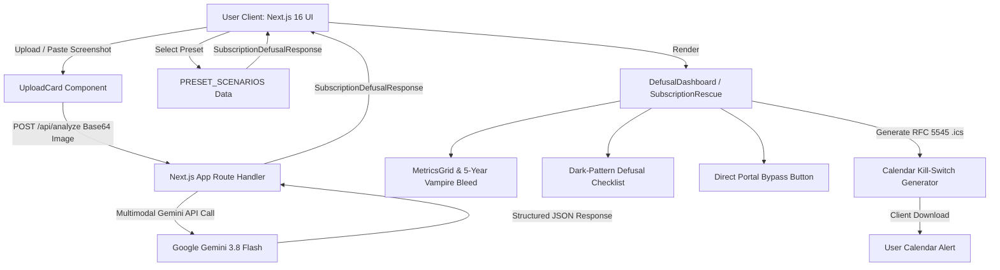

# CancelTrap 🛡️⚡

> **AI-Powered Dark-Pattern Subscription Defuser & 1-Click Trial Kill-Switch**  
> *Defuse sneaky cancellation mazes, expose decoy buttons, calculate compounding financial bleed, and terminate recurring charges before your card gets hit.*

[](https://nextjs.org/)
[](https://react.dev/)
[](https://www.typescriptlang.org/)
[](https://tailwindcss.com/)
[](https://ai.google.dev/)
[](LICENSE)

---

## 📌 Table of Contents

- [Overview](#overview)
- [The Problem: The SaaS Dark-Pattern Trap](#the-problem-the-saas-dark-pattern-trap)
- [Key Features](#key-features)
- [How It Works](#how-it-works)
- [Architecture & Data Flow](#architecture--data-flow)
- [Demo Presets](#demo-presets)
- [Tech Stack](#tech-stack)
- [Getting Started](#getting-started)
  - [Prerequisites](#prerequisites)
  - [Installation](#installation)
  - [Environment Variables](#environment-variables)
  - [Running the App](#running-the-app)
- [Project Structure](#project-structure)
- [Multimodal Gemini Contract](#multimodal-gemini-contract)
- [Privacy & Security](#privacy--security)
- [Contributing](#contributing)
- [License](#license)

---

## 🌟 Overview

**CancelTrap** is a proactive subscription defense platform built for developers, creators, and professionals who frequently sign up for modern developer tools, AI platforms, and creative SaaS trials.

Instead of scrambling through nested account settings, deciphering deceptive downgrade dialogs, or eating $240–$600+ in forgotten charges, CancelTrap uses **Multimodal Google Gemini AI** to inspect invoices, receipts, or trial confirmations and deliver an immediate **Defusal Dossier**:
1. **Direct Portal Bypass**: A direct link straight to the merchant's hidden cancellation portal.
2. **Dark-Pattern Breakdown**: Exposes decoy "Pause" buttons, confirmshaming, and multi-step traps.
3. **5-Year Vampire Bleed**: Compounding financial projection of what the subscription will drain if left running.
4. **1-Click Calendar Kill-Switch**: Generates pre-configured `.ics` calendar alerts (with alarms set 24–48 hours before renewal).

---

## 🛑 The Problem: The SaaS Dark-Pattern Trap

Modern subscription models rely heavily on behavioral friction and "roach motel" cancellation design:

* 🪤 **Decoy Options**: Deceptive "Pause Membership" buttons styled prominently while "Continue to Cancel" is hidden in low-contrast fine print.
* ⏳ **Surprise Auto-Renewals**: 7-day trials that silently convert to high-tier annual plans with hefty early-termination penalties.
* 🌀 **Multi-Page Obstacles**: Cancellation journeys buried behind 4 to 6 nested confirmation screens, surveys, and counter-offers.
* 🩸 **The "Vampire Bleed"**: Forgotten $20/month or $50/month subscriptions quietly compounding into thousands of dollars of lost capital over 3 to 5 years.

CancelTrap flips the script by giving users immediate clarity, direct bypass links, and zero-effort calendar reminders.

---

## ✨ Key Features

| Feature | Description |
| :--- | :--- |
| **Multimodal Gemini AI** | Drop a billing receipt, subscription settings screenshot, or invoice (or paste directly from your clipboard). Gemini extracts billing cycles, deadlines, and merchant terms in strict JSON. |
| **Interactive Demo Presets** | Instant, zero-friction demonstration scenarios (*Lovable Pro $20/mo trap*, *Adobe CC Annual early-termination fee*, *7-Day AI Generator trial*). |
| **Direct Portal Bypass** | Skips the nested settings labyrinth by navigating straight to the merchant's direct billing/cancellation endpoint. |
| **Dark Pattern Breakdown** | Pinpoints exact dark retention patterns (*Obstruction*, *Confirmshaming*, *Decoy Buttons*, *Hidden Penalties*) with severity indicators. |
| **Step-by-Step Defusal Guide** | Clear, step-by-step checklist advising exactly which buttons to click and which traps to ignore. |
| **5-Year Vampire Bleed** | Compounding financial projection widget illustrating long-term capital loss if the subscription goes uncancelled. |
| **1-Click `.ics` Kill-Switch** | Client-side RFC 5545 `.ics` calendar file generation with built-in alarms (compatible with Apple Calendar, Google Calendar, Outlook, and mobile devices). |
| **100% Stateless & Private** | Zero user database tracking, zero credential storage, and no backend retention of sensitive billing data. |

---

## 🔄 How It Works

```
1. Input           2. Gemini Analysis           3. Defusal Dossier
┌──────────────┐   ┌────────────────────────┐   ┌──────────────────────────────────┐
│ Drop / Paste │──>│ Multimodal Reasoning   │──>│ • Renewal countdown alert        │
│ Screenshot   │   │ - Strict JSON contract │   │ • 5-Year Vampire Bleed           │
│ or Preset    │   │ - Pattern detection    │   │ • Direct cancellation portal     │
└──────────────┘   └────────────────────────┘   │ • Step-by-step defusal checklist │
                                                │ • 1-Click .ics calendar alarm    │
                                                └──────────────────────────────────┘
```

1. **Upload or Select Preset**: Provide an invoice screenshot, subscription confirmation email, or choose one of our real-world presets.
2. **Sequential Scanning**: Watch the real-time AI scan inspect merchant terms, extract renewal deadlines, and flag dark patterns.
3. **Actionable Rescue**: Review the countdown, calculate financial drain, follow the step-by-step instructions, open the direct portal, and download your `.ics` calendar alarm.

---

## 🏗️ Architecture & Data Flow



---

## 🎯 Demo Presets

Try CancelTrap instantly without needing to take a screenshot:

1. **Lovable Pro ($20/mo Trap)**
   - *Pattern*: Decoy "Pause Subscription" button highlighted to deflect actual cancellation; hidden renewal dates.
   - *Financial Impact*: $1,200 5-year vampire bleed.
2. **Adobe Creative Cloud ($54.99/mo Annual Trap)**
   - *Pattern*: Hidden 50% early-termination penalty fee for cancelling annual contracts paid monthly, with a 4-step retention maze.
   - *Financial Impact*: $3,299 5-year vampire bleed.
3. **7-Day AI Generator ($29.99/mo Trial)**
   - *Pattern*: 7-day trial automatically rolls over into an expensive recurring charge with zero pre-renewal notification.
   - *Financial Impact*: $1,799 5-year vampire bleed.

---

## 💻 Tech Stack

- **Framework**: [Next.js 16](https://nextjs.org/) (App Router, Turbopack)
- **Library**: [React 19](https://react.dev/)
- **Language**: [TypeScript](https://www.typescriptlang.org/)
- **Styling**: [Tailwind CSS v4](https://tailwindcss.com/) with a custom glassmorphic design system
- **AI / LLM**: [Google Gen AI SDK (`@google/genai`)](https://www.npmjs.com/package/@google/genai) running `gemini-3.8-flash`
- **Icons**: [Lucide React](https://lucide.dev/)
- **Calendar Standard**: RFC 5545 zero-dependency `.ics` generator with `VALARM` reminder alerts

---

## 🚀 Getting Started

### Prerequisites

Ensure you have the following installed:
- [Node.js](https://nodejs.org/) (v18.18.0 or newer)
- [npm](https://www.npmjs.com/) (or `pnpm` / `yarn` / `bun`)
- A [Google Gemini API Key](https://aistudio.google.com/)

### Installation

1. **Clone the repository**:
   ```bash
   git clone https://github.com/Peacsib/canceltrap.git
   cd canceltrap
   ```

2. **Install dependencies**:
   ```bash
   npm install
   ```

### Environment Variables

Create a `.env.local` file in the root directory:

```bash
cp .env.example .env.local
```

Add your Google Gemini API credentials:

```env
# Google Gemini API Configuration
GEMINI_API_KEY=your_gemini_api_key_here
GEMINI_MODEL=gemini-3.8-flash
```

> **Note**: Demo presets work out-of-the-box without an API key. A valid `GEMINI_API_KEY` is only required when analyzing live custom screenshots.

### Running the App

Start the development server:

```bash
npm run dev
```

Open [http://localhost:3000](http://localhost:3000) in your browser to view CancelTrap.

To create an optimized production build:

```bash
npm run build
npm run start
```

---

## 📂 Project Structure

```plaintext
cancel-trap/
├── public/                     # Static assets, hero backdrops, and branding logos
│   ├── canceltrap-hero.png
│   └── canceltrap-logo.png
├── src/
│   ├── app/                    # Next.js App Router
│   │   ├── api/
│   │   │   └── analyze/        # Gemini multimodal route handler
│   │   │       └── route.ts
│   │   ├── globals.css         # Tailwind v4 & custom glass styling tokens
│   │   ├── layout.tsx          # Root layout and metadata
│   │   └── page.tsx            # Main application controller
│   ├── components/             # UI Components
│   │   ├── HeroLanding.tsx     # Hero section, upload card, and preset selector
│   │   ├── UploadCard.tsx      # File dropzone & clipboard paste handler
│   │   ├── SubscriptionRescue.tsx # Primary Defusal Dossier view
│   │   ├── MetricsGrid.tsx     # Renewal countdown & Vampire Bleed metrics
│   │   ├── DefusalChecklist.tsx # Interactive step-by-step action plan
│   │   ├── ActionHub.tsx       # Portal bypass & calendar kill-switch actions
│   │   └── DefusalDashboard.tsx # Dashboard orchestrator
│   ├── data/
│   │   └── presets.ts          # Curated demo subscription scenarios
│   └── lib/
│       ├── calendar.ts         # RFC 5545 .ics generator & download utility
│       └── types.ts            # SubscriptionDefusalResponse schema contract
├── .env.example                # Example environment configuration
├── package.json
└── README.md
```

---

## 📜 Multimodal Gemini Contract

CancelTrap relies on a strict, typed JSON contract (`SubscriptionDefusalResponse`) enforced server-side via `responseMimeType: "application/json"`:

```typescript
export interface SubscriptionDefusalResponse {
  isSubscription: boolean;
  unrecognizedReason?: string;
  merchant: {
    name: string;
    category: string;
    directPortalUrl: string;
    finePrintNotes?: string;
  };
  billing: {
    amount: number;
    currency: string;
    billingCycle: "monthly" | "annual" | "weekly" | "trial";
    renewalDate: string;
    daysUntilRenewal: number;
    vampireBleed5Year: number;
  };
  darkPattern: {
    detected: boolean;
    patternType: string;
    severity: "critical" | "warning" | "info";
    summary: string;
    tricksExposed: string[];
  };
  defusalChecklist: {
    stepNumber: number;
    instruction: string;
    decoyWarning?: string;
  }[];
  killSwitch: {
    eventTitle: string;
    suggestedAlertDate: string;
    alertMinutesBefore: number;
    eventDescription: string;
  };
}
```

---

## 🔒 Privacy & Security

- **Zero-Storage Architecture**: CancelTrap operates completely statelessly. We do not store or persist screenshots, credit card numbers, or personal accounts in any database.
- **Client-Side Processing**: Calendar `.ics` files are synthesized and downloaded directly on your client machine with no third-party tracking.
- **Direct Redirection**: All direct cancellation links navigate you straight to official merchant portals.

---

## 🤝 Contributing

Contributions, issues, and feature requests are welcome!

1. Fork the project
2. Create your feature branch (`git checkout -b feature/AmazingFeature`)
3. Commit your changes (`git commit -m 'feat: add amazing feature'`)
4. Push to the branch (`git push origin feature/AmazingFeature`)
5. Open a Pull Request

---

## 📄 License

Distributed under the **MIT License**. See `LICENSE` for more information.

---

<p align="center">
  Built with ❤️ for the <b>Devpost Build With AI</b> Hackathon
</p>
