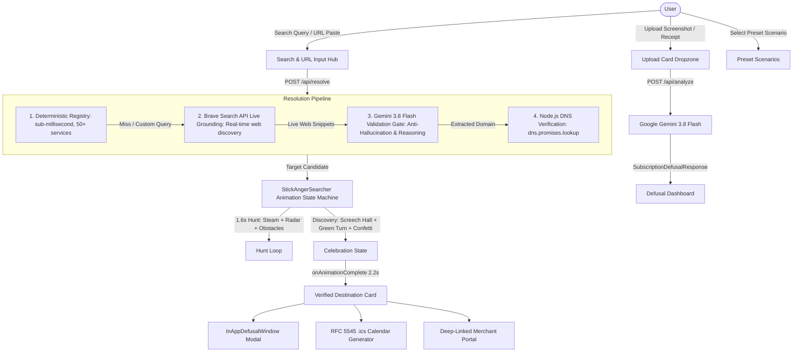

# CancelTrap 🛡️⚡

> **AI-Powered Dark-Pattern Subscription Defuser & 1-Click Trial Kill-Switch**  
> *Defuse sneaky cancellation mazes, expose decoy buttons, calculate compounding financial bleed, and terminate recurring charges before your card gets hit.*

[](https://canceltrap.vercel.app)
[](https://github.com/Peacsib/canceltrap)
[](https://canceltrap.vercel.app)
[](https://nextjs.org/)
[](https://react.dev/)
[](https://www.typescriptlang.org/)
[](https://tailwindcss.com/)
[](https://ai.google.dev/)
[](https://brave.com/search/api/)
[](LICENSE)

---

## 📌 Table of Contents

- [Live Demo & Video](#-live-demo--video)
- [Inspiration: The Mother's Story](#-inspiration-the-mothers-story)
- [Overview](#-overview)
- [The Problem: The SaaS Dark-Pattern Trap](#-the-problem-the-saas-dark-pattern-trap)
- [Key Features](#-key-features)
- [How It Works](#-how-it-works)
- [Architecture & Multi-Stage Discovery](#-architecture--multi-stage-discovery)
- [Enjoyous Comic Search Animation](#-enjoyous-comic-search-animation)
- [Universal Brand Marks & Regional Support](#-universal-brand-marks--regional-support)
- [Demo Presets](#-demo-presets)
- [Tech Stack](#-tech-stack)
- [Getting Started](#-getting-started)
  - [Prerequisites](#prerequisites)
  - [Installation](#installation)
  - [Environment Variables](#environment-variables)
  - [Running the App](#running-the-app)
- [Project Structure](#-project-structure)
- [Multimodal Gemini Contract](#-multimodal-gemini-contract)
- [Privacy & Security](#-privacy--security)
- [License](#-license)

---

## 🌐 Live Demo & Video

* **Live Web App**: [https://canceltrap.vercel.app](https://canceltrap.vercel.app)
* **GitHub Repository**: [https://github.com/Peacsib/canceltrap](https://github.com/Peacsib/canceltrap)
* **Demo Video**: Complete product demonstration recorded and submitted for Devpost evaluation.

---

## 💡 Inspiration: The Mother's Story

The idea for CancelTrap came from sitting next to my mother at her kitchen table. 

She noticed an unexpected charge on her monthly bank statement and was distraught. Months earlier, she had used what looked like a free 7-day document converter trial for a single family task. When the trial ended, it quietly rolled into an expensive monthly subscription.

She tried to cancel it herself, but was trapped by dark patterns:
- Prominently styled green "Pause Membership" buttons designed to deflect actual cancellation.
- Tiny, low-contrast "Continue to Cancel" links buried at the bottom of 4-step retention surveys.
- Confusing downgrade mazes that tricked her into staying enrolled.

Even as a software engineer, it took me nearly 15 minutes of digging through nested account settings and misleading prompts to finally terminate the charge. 

Seeing how predatory these dark patterns are against non-technical parents and busy consumers made it personal. We built **CancelTrap** to put an end to recurring subscription traps: giving everyone a 1-click defusal weapon that cuts through dark patterns, exposes decoy traps, and terminates recurring subscriptions before money leaves your account.

---

## 🌟 Overview

**CancelTrap** is a proactive subscription defense platform built for developers, creators, parents, and consumers who sign up for modern developer tools, AI platforms, streaming media, and mobile telecom services.

Instead of scrambling through nested account settings, deciphering deceptive downgrade dialogs, or eating $240–$600+ in forgotten charges, CancelTrap pairs **Brave Search API Live Grounding** with **Google Gemini 3.8 Flash** to deliver an immediate, entertaining **Defusal Dossier**:

1. **Split Hero Landing**: On the right panel, a free-roaming **BlueStickFighter** — an autonomous SVG martial-arts stick figure — punches, kicks, spins, and dances as it takes on subscription brand logos, giving instant visual delight while the user decides to search.
2. **Direct Portal Bypass**: Real, verified deep links straight to the merchant's hidden cancellation portal.
3. **Brave Search Live Grounding**: Real-time live web intelligence querying the Brave Search API to discover live merchant URLs, settings endpoints, and cancellation terms for uncataloged queries.
4. **Enjoyous Comic Search Experience**: An animated stick figure hunter sprinting corner-to-corner puffing ear steam, dodging decoy traps, and celebrating with an emerald confetti victory dance.
5. **In-App Defusal Co-Pilot**: An interactive side-by-side guidance modal walking you through cancellation steps.
6. **Dark-Pattern Breakdown**: Exposes decoy "Pause" buttons, confirmshaming, and multi-step traps.
7. **5-Year Vampire Bleed**: Compounding financial projection of what the subscription will drain if left running.
8. **1-Click Calendar Kill-Switch**: Pre-configured `.ics` calendar alerts (with alarms set 24–48 hours before renewal).
9. **Calibrated Mobile Experience**: Full first-screen hero viewport on mobile, natural scroll to the defusal arena, and sticky frosted tab navigation pills.

---

## 🛑 The Problem: The SaaS Dark-Pattern Trap

Modern subscription models rely heavily on behavioral friction and "roach motel" cancellation design:

* 🪤 **Decoy Options**: Deceptive "Pause Membership" buttons styled prominently while "Continue to Cancel" is hidden in low-contrast fine print.
* ⏳ **Surprise Auto-Renewals**: 7-day trials that silently convert to high-tier annual plans with hefty early-termination penalties.
* 🌀 **Multi-Page Obstacles**: Cancellation journeys buried behind 4 to 6 nested confirmation screens, surveys, and counter-offers.
* 🌍 **Regional Telecom Deductions**: Mobile airtime and wallet bundles (e.g. Econet `ecoAI` in Zimbabwe) that auto-deduct credit without clear web opt-outs.
* 🩸 **The "Vampire Bleed"**: Forgotten $20/month or $50/month subscriptions quietly compounding into thousands of dollars of lost capital over 3 to 5 years.

CancelTrap flips the script by giving users immediate clarity, direct bypass links, and zero-effort calendar reminders.

---

## ✨ Key Features

| Feature | Description |
| :--- | :--- |
| **Universal Search & URL Resolver** | Type any service name or paste any billing URL. High-res logo suggestions populate in real time with verified domain badges. |
| **Brave Search API Live Grounding** | Queries the Brave Search API in real time for uncataloged or newly launched services, providing verified web ground truth to the AI. |
| **Node.js DNS Validation Gate** | Verifies candidate domains using `dns.promises.lookup` to prevent hallucinated or dead `.io`/`.com` links. |
| **Anti-Hallucination Safe-Guard** | Rejects non-existent or gibberish queries (`asdfghjk99`) with a clean security shield rather than inventing fake domains. |
| **BlueStickFighter Hero Animation** | Autonomous SVG martial-arts stick figure on the hero panel: free-roams, dodges, spins, dances, and strikes 9 subscription brand logos with comic hit tags (POW! BAM! ZAP!) and recoil effects. |
| **Enjoyous Comic Search Animation** | Hand-drawn cartoon stick runner puffing ear steam, flying sweat drops, wielding a radar scanner, dodging trap obstacles, and celebrating with a Golden Key 🗝️ and emerald confetti shower! |
| **Presets Search & Victory Celebration** | Clicking any preset chip (AWS, Google Cloud, Adobe, Microsoft 365, ChatGPT, Lovable, Figma, Wikipedia, Blender) plays the full hunting sequence and victory celebration. |
| **Universal Brand Marks** | High-res 128px logos powered by Google Favicon API with regional telecom flags (e.g. `🇿🇼 ZIM` for Econet Zimbabwe). |
| **Zero-Billing Free Software Mode** | 100% free / open-source software (e.g. Wikipedia, Blender) display an emerald shield (`🛡️ Free Forever`), showing `$0.00` and directing users to official sites without false cancellation alarms. |
| **Regional Provider Support** | Deep support for regional mobile telecom deductions (USSD `*449#`, SMS `STOP`, and web portals). |
| **In-App Defusal Co-Pilot** | Side-by-side floating modal guiding users step-by-step through third-party cancellation mazes. |
| **Multimodal Gemini AI** | Drop or paste a billing receipt screenshot. Gemini 3.8 Flash extracts renewal terms, deadlines, and dark patterns in strict JSON. |
| **5-Year Vampire Bleed** | Compounding financial projection widget illustrating long-term capital loss if the subscription goes uncancelled. |
| **1-Click `.ics` Kill-Switch** | Client-side RFC 5545 `.ics` calendar file generation with built-in alarms (Apple Calendar, Google Calendar, Outlook). |
| **Mobile-Calibrated UX** | Dedicated full first-screen viewport on mobile (`min-h-[calc(100svh-5.5rem)]`), hidden footer cards (`hidden md:block`), and sticky top frosted navigation pill tabs. |
| **WebP Image Optimisation** | All static images converted to sharp WebP (logo: -72%, hero bg: -98%), unused assets removed. |
| **100% Stateless & Private** | Zero user database tracking, zero credential storage, and no backend retention of billing data. |

---

## 🔄 How It Works

```
1. Input               2. Multi-Stage Discovery       3. Defusal Dossier
┌──────────────────┐   ┌──────────────────────────┐   ┌──────────────────────────────────┐
│ • Service Search │──>│ • Deterministic Registry │──>│ • Direct portal bypass link      │
│ • URL Paste      │   │ • Brave Search Grounding │   │ • In-App Defusal Co-Pilot        │
│ • Screenshot     │   │ • Gemini AI Validation   │   │ • 5-Year Vampire Bleed           │
│ • Preset Pill    │   │ • DNS Lookup Check       │   │ • Step-by-step defusal guide     │
└──────────────────┘   └──────────────────────────┘   │ • 1-Click .ics calendar alarm    │
                                                      └──────────────────────────────────┘
```

1. **Search or Select**: Enter any service name (e.g., `ecoai`, `strava`, `lovable`), select a preset chip, or drop an invoice screenshot.
2. **Enjoyous Cartoon Hunt**: Watch the angry stick runner sprint corner-to-corner with steam billowing from his ears, cycling funny quips, dodging decoy traps, and celebrating in emerald green with confetti when found.
3. **Actionable Defusal**: Open the direct cancellation portal, follow the step-by-step co-pilot guide, calculate financial drain, and download your `.ics` calendar alarm.

---

## 🏗️ Architecture & Multi-Stage Discovery



---

## 🎭 Enjoyous Comic Search Animation

Modeled after authentic hand-drawn sketches, the search animation replaces boring spinners with an entertaining character journey:

* 🏃 **Sprint Physics**: Slanted angry eyebrows, clenched gritted teeth, pumping scissor legs, and cartoon speed lines.
* 💨 **Steam & Sweat**: Billowing ear steam clouds (`~~~☁️`) and flying sweat droplets (`💦`).
* 🔍 **Scanner with Radar Beam**: Projects an active cyan radar beam sweeping the track for hidden cancel buttons.
* 🛡️ **Dodging Track Obstacles**: Leaps over `🚫 "Don't go!"` popups, `📋 12-Page Survey` roadblocks, and `🔍 2pt Tiny Link` traps.
* 💬 **Upright Comic Dialogue**: Cycling quips (*"WHERE IS THE CANCELLATION BUTTON?! IT'S NOT IN THE FOOTER! 😤"*) that never mirror backwards when turning around.
* 🗝️ **Emerald Victory Celebration**: Screeches to a halt, flashes into radiant emerald green (`#10b981`), beams a wide cartoon grin, brandishes the **Golden Key of Defusal 🗝️**, and celebrates in a 10-piece confetti shower!

---

## 🌐 Universal Brand Marks & Regional Support

* **Universal 128px Favicons**: Resolves high-resolution, recognizable brand logos for any web service globally using Google's Favicon API.
* **Regional Telecom Defusal**:
  * **Econet Wireless Zimbabwe (`ecoAI`)**: Identifies real domain (`ecoaitoken.co.zw`), displays Zimbabwean flag badge (`🇿🇼 ZIM`), and provides USSD shortcode defusal (`*449#`), SMS opt-outs (`STOP` to `449`), and direct web portal links.

---

## 🎯 Demo Presets

Try CancelTrap instantly without needing to take a screenshot:

1. **Lovable Pro ($20/mo Trap)**
   - *Pattern*: Decoy "Pause Subscription" button highlighted to deflect actual cancellation; hidden renewal dates.
   - *Financial Impact*: $1,200 5-year vampire bleed.
2. **Adobe Creative Cloud ($54.99/mo Annual Trap)**
   - *Pattern*: Hidden 50% early-termination penalty fee for cancelling annual contracts paid monthly, with a 4-step retention quiz.
   - *Financial Impact*: $3,299 5-year vampire bleed.
3. **7-Day AI Generator ($29.99/mo Trial)**
   - *Pattern*: 7-day trial automatically rolls over into an expensive recurring charge with zero pre-renewal notification.
   - *Financial Impact*: $1,799 5-year vampire bleed.
4. **Wikipedia / Blender (Free Software Mode)**
   - *Pattern*: 100% free / open-source software, zero recurring billing risk, emerald shield of safety.

---

## 💻 Tech Stack

- **Framework**: [Next.js 16](https://nextjs.org/) (App Router, Turbopack)
- **Library**: [React 19](https://react.dev/)
- **Language**: [TypeScript](https://www.typescriptlang.org/)
- **Styling**: [Tailwind CSS v4](https://tailwindcss.com/) with custom glassmorphic tokens
- **AI / LLM**: [Google Gen AI SDK (`@google/genai`)](https://www.npmjs.com/package/@google/genai) running `gemini-3.8-flash`
- **Live Web Grounding**: [Brave Search API](https://brave.com/search/api/) (`searchBraveWeb`)
- **DNS Verification**: Node.js `dns.promises.lookup` anti-hallucination guardrail
- **Icons**: [Lucide React](https://lucide.dev/)
- **Calendar Standard**: RFC 5545 zero-dependency `.ics` generator with `VALARM` reminder alerts

---

## 🚀 Getting Started

### Prerequisites

Ensure you have the following installed:
- [Node.js](https://nodejs.org/) (v18.18.0 or newer)
- [npm](https://www.npmjs.com/) (or `pnpm` / `yarn` / `bun`)
- A [Google Gemini API Key](https://aistudio.google.com/)
- (Optional) A [Brave Search API Key](https://brave.com/search/api/) for live uncataloged web searches

### Installation

1. **Clone the repository**:
   ```bash
   git clone https://github.com/Peacsib/canceltrap.git
   cd canceltrap
   ```

2. **Install dependencies**:
   ```bash
   npm install
   ```

### Environment Variables

Create a `.env.local` file in the root directory:

```bash
cp .env.example .env.local
```

Add your API credentials:

```env
# Google Gemini API Configuration
GEMINI_API_KEY=your_gemini_api_key_here
GEMINI_MODEL=gemini-3.8-flash

# Brave Search API Configuration (Optional for live uncataloged queries)
BRAVE_SEARCH_API_KEY=your_brave_search_api_key_here
```

> **Note**: Demo presets and the 50+ deterministic registry services work out-of-the-box without an API key. A valid `GEMINI_API_KEY` is required when analyzing custom screenshots or running AI validation. `BRAVE_SEARCH_API_KEY` powers live web discovery for uncataloged queries.

### Running the App

Start the development server:

```bash
npm run dev
```

Open [http://localhost:3000](http://localhost:3000) in your browser to view CancelTrap.

To create an optimized production build:

```bash
npm run build
npm run start
```

---

## 📂 Project Structure

```plaintext
cancel-trap/
├── devpost/                    # Hackathon documentation artifacts
│   ├── learner-profile.md      # Learner journey & key insights
│   ├── scope.md                # Scope & proof-of-concept boundaries
│   ├── prd.md                  # Complete product requirements
│   ├── spec.md                 # Technical blueprint & architecture
│   └── checklist.md            # Build checklist & verification records
├── public/                     # Static assets & optimized WebP media
│   ├── canceltrap-logo.webp    # Crisp transparent branding logo (183 KB)
│   └── newhero.webp            # Optimized atmospheric water caustics background (34 KB)
├── src/
│   ├── app/                    # Next.js App Router
│   │   ├── api/
│   │   │   ├── analyze/        # Gemini multimodal screenshot route
│   │   │   │   └── route.ts
│   │   │   └── resolve/        # Multi-stage resolution pipeline route
│   │   │       └── route.ts
│   │   ├── dashboard/          # Dedicated dashboard page
│   │   ├── globals.css         # Tailwind v4 & custom glass styling tokens
│   │   ├── layout.tsx          # Root layout and metadata
│   │   └── page.tsx            # Main application controller
│   ├── components/             # UI Components
│   │   ├── DefusalDashboard.tsx # Main dashboard & brand logo engine
│   │   ├── StickAngerSearcher.tsx # Enjoyous comic stick figure animation
│   │   ├── BlueStickFighter.tsx # Autonomous hero martial-arts stick figure
│   │   ├── BasketServices.tsx  # Orbiting subscription brand logos
│   │   ├── InAppDefusalWindow.tsx # Side-by-side cancellation co-pilot
│   │   ├── DestinationRescue.tsx # Destination card presentation
│   │   ├── HeroLanding.tsx     # Hero section, upload card, and preset selector
│   │   ├── UploadCard.tsx      # File dropzone & clipboard paste handler
│   │   ├── MetricsGrid.tsx     # Renewal countdown & Vampire Bleed metrics
│   │   ├── DefusalChecklist.tsx # Interactive step-by-step action plan
│   │   └── ActionHub.tsx       # Portal bypass & calendar kill-switch actions
│   ├── data/
│   │   └── presets.ts          # Curated demo subscription scenarios
│   └── lib/
│       ├── calendar.ts         # RFC 5545 .ics generator & download utility
│       ├── engine/
│       │   ├── liveDiscovery.ts # Brave Search API live web intelligence scraper
│       │   └── registry.ts     # 50+ deterministic service defusal rules
│       ├── gemini.ts           # Gemini API client & schema definitions
│       └── types.ts            # Schema definitions & TypeScript interfaces
├── .env.example                # Example environment configuration
├── package.json
└── README.md
```

---

## 📜 Multimodal Gemini Contract

CancelTrap enforces a typed JSON contract (`SubscriptionDefusalResponse`) server-side via `responseMimeType: "application/json"`:

```typescript
export interface SubscriptionDefusalResponse {
  isSubscription: boolean;
  unrecognizedReason?: string;
  merchant: {
    name: string;
    category: string;
    directPortalUrl: string;
    finePrintNotes?: string;
  };
  billing: {
    amount: number;
    currency: string;
    billingCycle: "monthly" | "annual" | "weekly" | "trial";
    renewalDate: string;
    daysUntilRenewal: number;
    vampireBleed5Year: number;
  };
  darkPattern: {
    detected: boolean;
    patternType: string;
    severity: "critical" | "warning" | "info";
    summary: string;
    tricksExposed: string[];
  };
  defusalChecklist: {
    stepNumber: number;
    instruction: string;
    decoyWarning?: string;
  }[];
  killSwitch: {
    eventTitle: string;
    suggestedAlertDate: string;
    alertMinutesBefore: number;
    eventDescription: string;
  };
}
```

---

## 🔒 Privacy & Security

- **Zero-Storage Architecture**: CancelTrap operates completely statelessly. We do not store or persist screenshots, credit card numbers, or personal accounts in any database.
- **Client-Side Processing**: Calendar `.ics` files are synthesized and downloaded directly on your client machine with no third-party tracking.
- **Direct Redirection**: All direct cancellation links navigate you straight to official merchant portals.

---

## 📄 License

Distributed under the **MIT License**. See `LICENSE` for more information.

---

<p align="center">
  Built with ❤️ for the <b>Devpost Build With AI</b> Hackathon
</p>
