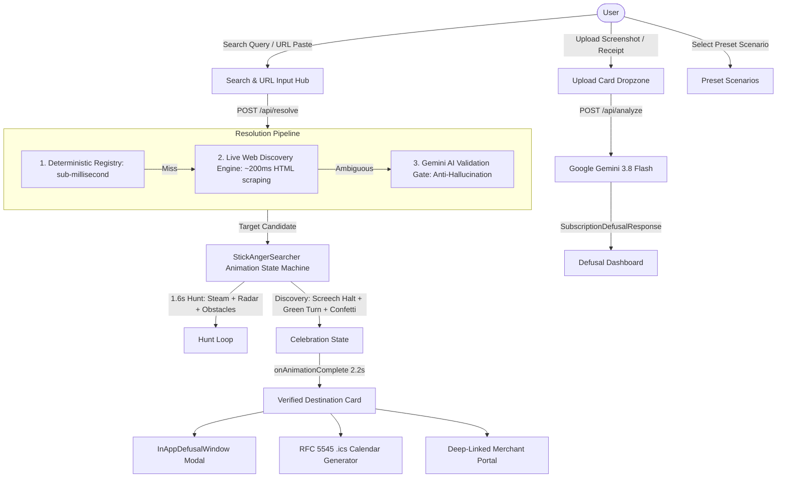

# CancelTrap — Technical Spec

## System Architecture

CancelTrap is built as a high-performance, stateless Next.js 16 (App Router) web application designed to help consumers defuse deceptive cancellation mazes, expose hidden auto-renewals, and generate instant calendar kill-switches.



---

## The Core Pipeline

### 1. Multi-Stage Resolution Pipeline (`src/app/api/resolve/route.ts`)
1. **Tier 1 — Sub-millisecond Deterministic Registry (`src/lib/engine/registry.ts`)**:
   - Checks against 50+ hand-curated services (AWS, Google Cloud, Adobe, Microsoft 365, ChatGPT, Lovable, Figma, Netflix, Spotify, Econet Zimbabwe `ecoAI`, etc.).
   - Provides verified direct cancellation URLs, step breadcrumbs, and dark pattern warnings without network calls.
2. **Tier 2 — Real-Time Live Web Discovery Engine (`src/lib/engine/liveDiscovery.ts`)**:
   - If the query is uncataloged or newly launched, runs zero-cost live web queries against search indexing.
   - Extracts canonical domain names (e.g. `strava.com`, `ecoaitoken.co.zw`), strips aggregator spam, detects navigation keywords (`settings/account`, `manage subscription`), and formats actionable steps.
3. **Tier 3 — Google Gemini 3.8 Flash Validation Gate**:
   - Cross-references extracted signals to verify authenticity.
   - **Anti-Hallucination Guard**: Obvious nonsense queries (`asdfghjk99`, `testfakexyz`) are rejected with `{ resolved: false, isFakeOrUnrecognized: true }` rather than fabricating fake URLs.

### 2. Multimodal Screenshot Analysis (`src/app/api/analyze/route.ts`)
- Accepts base64 encoded images (`image/png`, `image/jpeg`, `image/webp`).
- Invokes **Google Gemini 3.8 Flash** with system instructions enforcing the `SubscriptionDefusalResponse` JSON schema.
- Extracts merchant identity, renewal date/countdown, recurring billing price, 5-year vampire bleed, and dark pattern breakdown.

### 3. Enjoyous Comic Search Animation (`src/components/StickAngerSearcher.tsx`)
- Modeled directly on the user's hand-drawn sketches.
- **SVG Anatomy**:
  - Head: Round skull, 3 spiky cowlick hairs, slanted angry V-eyebrows, piercing pupils, and rectangular gritted-teeth mouth with vertical tooth separators.
  - Smoke System: Billowing ear steam plumes (`~~~☁️`) and head heat squiggles.
  - Props: Oversized cartoon scanner projecting a cyan radar beam, cartoon running dust puffs, and flying sweat droplets (`💦`).
- **CSS Animation Engine**:
  - `trackSlide`: Smooth corner-to-corner oscillation between `7%` and `72%` width.
  - `flipRunner`: Direction flipping isolated to the SVG character (`scaleX(1)` / `scaleX(-1)`) while speech bubbles remain **unflipped and upright at all times**.
  - `victoryBounce`: Screeching brake to the center, instant color shift to emerald green (`#10b981`), open smiling face with rosy cheeks, and raised hands brandishing the **Golden Key of Defusal 🗝️**.
  - `animate-confetti`: 10-piece multi-color confetti explosion showering down.

### 3b. Hero Panel — BlueStickFighter (`src/components/BlueStickFighter.tsx`)
- Autonomous SVG martial-arts stick figure displayed on the **right panel of the Hero Landing** inside `BasketServices.tsx`.
- **Autonomous Behaviour Loop**: Free-roams the canvas using a `setInterval` state machine cycling through `idle → patrol → run → targetStrike → dodge → spin → dance → jump` states.
- **Strike System**: Randomly selects one of the 9 subscription brand logos orbiting the basket, sprints to it, lands a context-aware hit (kick, punch, box, beat), triggers a floating comic hit tag (POW! / BAM! / ZAP! / BONK!), and the struck logo plays a CSS recoil animation (`.logo-recoil-hit`).
- **Zero Sound**: All automatic hit sound playback is disabled (muted per user request); the fighter operates silently.

### 4. In-App Defusal Guide Co-Pilot (`src/components/InAppDefusalWindow.tsx`)
- Floating side-by-side modal allowing users to keep step-by-step guidance visible while navigating third-party cancellation portals.
- Interactive step checkmarks, decoy button warnings, and direct portal launcher.

### 5. Universal Brand Mark Engine (`DynamicBrandIcon`)
- Queries Google's universal 128px high-res favicon service (`https://www.google.com/s2/favicons?domain=${domain}&sz=128`).
- Fallbacks to DuckDuckGo favicon API, followed by styled initials.
- Special vector badges for regional entities (e.g. Econet Wireless Zimbabwe with `🇿🇼 ZIM` flag).

### 6. Client-Side Calendar Kill-Switch (`src/lib/calendar.ts`)
- Pure zero-dependency TypeScript implementation of RFC 5545 iCalendar standard.
- Pre-configures a reminder event scheduled 24–48 hours prior to renewal with a 2-hour pre-alarm (`VALARM`).

---

## Technical Stack

| Layer | Technology | Rationale |
| :--- | :--- | :--- |
| **Framework** | Next.js 16 (App Router) | High-performance React 19 server components, Turbopack, and isolated route handlers. |
| **Language** | TypeScript 5 (Strict Mode) | Full type safety across API boundaries and component props. |
| **Styling** | Tailwind CSS v4 | Rapid glassmorphism, lab colors, and hardware-accelerated animations. |
| **AI / Multimodal** | Google Gen AI SDK (`@google/genai`) | Low-latency multimodal reasoning with strict structured JSON schema enforcement. |
| **Live Web Discovery** | Zero-Cost Web Engine (`liveDiscovery.ts`) | Real-time domain resolution without API rate limits or quota costs. |
| **Icons** | Lucide React | Clean, responsive vector icons for UI state indicators. |
| **Calendar Standard** | RFC 5545 (`.ics`) | Zero-dependency client-side calendar file synthesis. |

---

## Data Models

### 1. `DestinationResult` (Resolution Pipeline)
```typescript
export interface DestinationResult {
  id: string;
  providerName: string;
  providerDomain: string;
  actionTitle: string;
  actionType: "cancel_subscription" | "downgrade_tier" | "delete_account" | "turn_off_autorenew";
  targetUrl: string;
  navigationPath: {
    stepNumber: number;
    instruction: string;
    decoyWarning?: string;
  }[];
  darkPatternWarnings: string[];
  product?: string;
  verifiedBy: "registry" | "algorithmic_discovery" | "ai_validated";
  regionalContext?: {
    country: string;
    carrier?: string;
    ussdCode?: string;
    smsCommand?: string;
  };
}
```

### 2. `SubscriptionDefusalResponse` (Screenshot Multimodal Model)
```typescript
export interface SubscriptionDefusalResponse {
  isSubscription: boolean;
  unrecognizedReason?: string;
  merchant: {
    name: string;
    category: string;
    directPortalUrl: string;
    finePrintNotes?: string;
  };
  billing: {
    amount: number;
    currency: string;
    billingCycle: "monthly" | "annual" | "weekly" | "trial";
    renewalDate: string;
    daysUntilRenewal: number;
    vampireBleed5Year: number;
  };
  darkPattern: {
    detected: boolean;
    patternType: string;
    severity: "critical" | "warning" | "info";
    summary: string;
    tricksExposed: string[];
  };
  defusalChecklist: {
    stepNumber: number;
    instruction: string;
    decoyWarning?: string;
  }[];
  killSwitch: {
    eventTitle: string;
    suggestedAlertDate: string;
    alertMinutesBefore: number;
    eventDescription: string;
  };
}
```

---

## File Structure

```
cancel-trap/
├── devpost/                      # Hackathon documentation artifacts
│   ├── learner-profile.md        # Learner journey & key insights
│   ├── scope.md                  # Scope & proof-of-concept boundaries
│   ├── prd.md                    # Complete product requirements
│   ├── spec.md                   # Technical blueprint & architecture
│   └── checklist.md              # Build checklist & verification records
├── public/                       # Static assets & brand media
│   ├── canceltrap-logo.webp      # Transparent brand mark (WebP, 183 KB)
│   └── newhero.webp              # Water-glass hero backdrop (WebP, 34 KB)
├── src/
│   ├── app/
│   │   ├── api/
│   │   │   ├── analyze/route.ts  # Multimodal Gemini screenshot route
│   │   │   └── resolve/route.ts  # Multi-stage resolution pipeline
│   │   ├── dashboard/page.tsx    # Dedicated dashboard route
│   │   ├── globals.css           # Design tokens, gradients, animations
│   │   ├── layout.tsx            # Root layout with fonts & metadata
│   │   └── page.tsx              # Main orchestrator
│   ├── components/
│   │   ├── DefusalDashboard.tsx  # Central dashboard & brand logo engine
│   │   ├── StickAngerSearcher.tsx# Enjoyous comic stick figure animation
│   │   ├── BlueStickFighter.tsx  # Hero-panel free-roaming martial-arts fighter
│   │   ├── BasketServices.tsx    # Hero-right orbit of subscription brand logos
│   │   ├── InAppDefusalWindow.tsx# Side-by-side cancellation co-pilot
│   │   ├── DestinationRescue.tsx # Destination card presentation
│   │   ├── HeroLanding.tsx       # Split-viewport hero landing
│   │   ├── CleanWaterMotionBg.tsx# Atmospheric animated water background
│   │   ├── UploadCard.tsx        # Drag-and-drop receipt dropzone
│   │   ├── MetricsGrid.tsx       # 4 metric cards (Bleed, Price, Trap, Countdown)
│   │   ├── DefusalChecklist.tsx  # Step-by-step checklist
│   │   └── ActionHub.tsx         # Action buttons & kill switch generator
│   └── lib/
│       ├── calendar.ts           # RFC 5545 .ics calendar generator
│       ├── engine/
│       │   ├── liveDiscovery.ts  # Zero-cost live web intelligence scraper
│       │   └── registry.ts       # 50+ deterministic service defusal rules
│       ├── gemini.ts             # Gemini API client & schema definitions
│       └── types.ts              # TypeScript interface definitions
├── .env.example                  # Environment configuration template
├── package.json                  # Dependencies & scripts
└── README.md                     # Project documentation & demo guide
```

---

## Failure Modes & Safeguards

1. **Hallucinated Domains**: If a user searches for an uncataloged or regional service (e.g. `ecoai`), CancelTrap executes live web intelligence rather than guessing synthetic `.io`/`.com` domains, accurately identifying real portals (like `ecoaitoken.co.zw`).
2. **Fake or Fictional Queries**: Queries like `asdfghjk99` trigger anti-hallucination guardrails, returning an explanatory security banner rather than inventing fake steps.
3. **Gemini 429 Rate Limits**: The zero-cost live web discovery engine acts as a fallback layer that operates independently of LLM API quotas.
4. **Mirrored Text in CSS Flip**: Isolated subcontainers ensure speech bubble text remains readable left-to-right when the running stick figure turns around.
